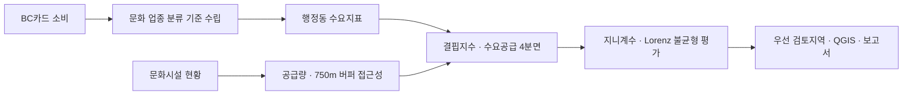
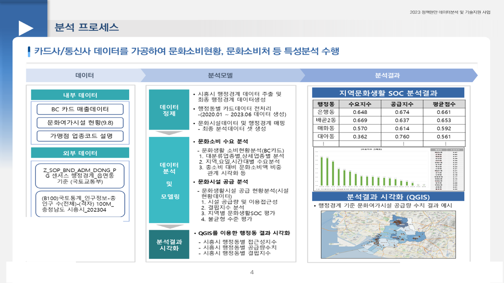
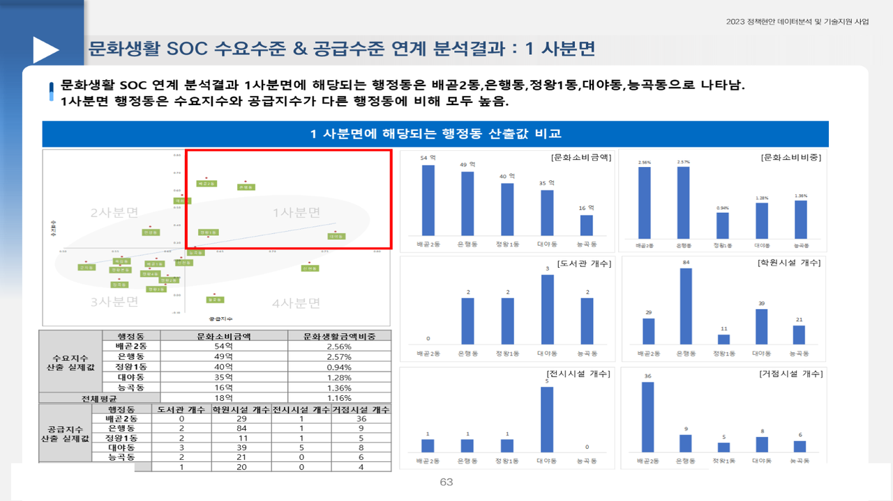
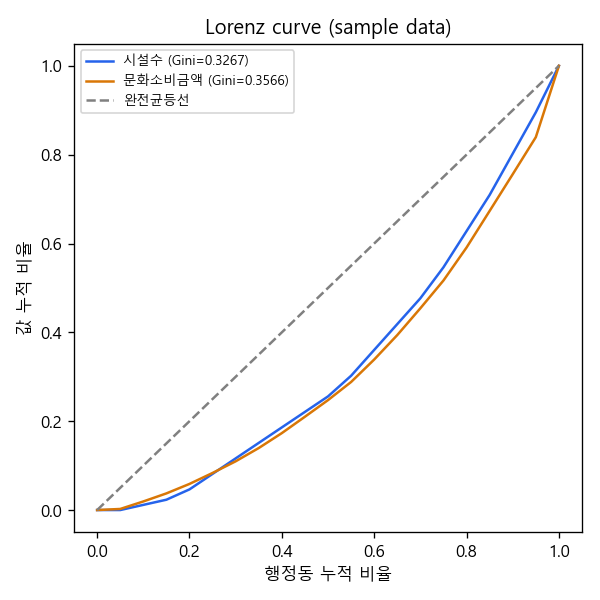

# 시흥시 지역문화생활 SOC 분석모형 수립

2023.07 – 2023.10 · 라임솔루션 (발주처: 경기 시흥시) · 역할: 전 과정 (업종 분류 기준 · 수요·공급·접근성 지표 · 4분면 · 지니계수 · QGIS · 보고서), 단독 수행

## 프로젝트 소개
지역 간 문화생활 격차 해소를 위해 생활 SOC(도서관·문화시설 등) 확충 우선지역을 데이터로 정하는 **재사용 가능한 분석모형**을 설계했다 (분석설계서 2023.11.13, 최종보고 2023.12.28 v2).
원 분석은 QGIS(버퍼·서비스권역)와 Excel로 수행되어 별도의 Python 납품 코드가 없다. 이 레포는 **방법론 문서 중심**이며, `src/reconstruct_indicators.py`는 지표 산출 로직을 합성 샘플에 적용해 보이는 **재구성 예시**이지 원 납품 코드가 아니다.

## 문제 정의
- 배경: 지역 간 문화생활 격차 해소를 위해 생활 SOC 확충 우선지역을 데이터로 정해야 함
- 질문: 행정동별 문화소비 수요 대비 시설 공급·접근성이 얼마나 부족한가, 어디를 먼저 검토해야 하는가

## 데이터
| 데이터 | 출처 | 규모 | 공개 여부 |
|---|---|---|---|
| BC카드 소비데이터(문화·여가 업종) | BC카드 | 2020.01 – 2023.06, 행정동·요일·시간대 | 계약 데이터, 비공개 |
| 문화여가시설 현황 | 시흥시 (2023.09.08) | 시설 단위 | 발주처 제공, 레포 미포함 |
| 100m 격자 인구, 행정경계(거북섬동 반영) | 국토부·통계청 | 시흥시 | 공공 |

- **원천 데이터, QGIS 프로젝트, 결과 파일은 포함하지 않는다.**
- 합성 샘플 `data/sample/dong_demand_supply_sample.csv`(행정동 20개, numpy seed 42 난수)로 재구성 스크립트를 실행할 수 있다. 실제 시흥시 값과 무관하다.

## 분석 방법
1. **수요**: BC카드 업종체계에서 문화소비 **10개 업종** 기준 수립(악기점·음반·골동품·화랑·공예품 등 포함, 골프장·야영장 제외). 총소비 대비 문화소비 비중의 연도별·지역·요일·시간대별 분석
2. **공급·접근성**: 시설 공급량, **750m 버퍼** 기반 이용접근성(도서관 등)
3. **결핍지수**: 공급량·접근성 결합 → 수요·공급 **4분면 분석**
4. **불균형**: 지니계수·Lorenz Curve로 시설 유형별 불균형 비교
5. QGIS 행정동 시각화, 분석모형 문서화

자세한 지표 정의는 [`docs/methodology.md`](docs/methodology.md).



## 기술 스택
Python, Pandas, QGIS(버퍼·서비스권역), 지니계수·Lorenz Curve, Excel · 재구성 스크립트: pandas, numpy, matplotlib

## 결과
- 수요 대비 공급이 부족한 취약지역과 **우선 검토지역** 도출
- 지자체가 재사용할 수 있는 **생활 SOC 분석모형** 구축(설계서 + 최종보고서)




재구성 스크립트가 샘플 데이터로 그린 Lorenz 곡선(설명용, 실제 결과 아님):



## 실행 방법
```bash
pip install pandas numpy matplotlib
python src/reconstruct_indicators.py   # 레포 루트에서 실행
```
- 입력: `data/sample/dong_demand_supply_sample.csv` (행정동, 문화소비금액, 총소비금액, 시설수, 접근성점수, 인구수)
- 출력: `data/sample/dong_indicators_result_sample.csv`(수요지수·공급지수·결핍지수·4분면), `docs/images/lorenz_curve_sample.png`
- 한글 폰트가 없는 환경에서는 그래프 라벨이 깨질 수 있다. 스크립트 상단의 폰트 목록을 환경에 맞게 수정한다.
- 이 스크립트는 **설명용 재구성**이다. 가중치(공급 0.5·접근성 0.5)와 4분면 기준(중앙값)은 예시이며 원 분석의 750m 버퍼 접근성은 QGIS에서 산출했다.

## 폴더 구조
```
siheung-cultural-soc/
├── README.md
├── .gitignore
├── docs/
│   ├── methodology.md            # 지표 정의 설명
│   └── images/                   # 캡쳐 + 샘플 Lorenz 곡선
├── src/
│   └── reconstruct_indicators.py # 재구성 예시 (원 납품 코드 아님)
└── data/sample/
    ├── dong_demand_supply_sample.csv
    ├── dong_indicators_result_sample.csv
    └── README.md
```

## 참고
- Obsidian 노트: `2023-07_시흥시_문화생활SOC_분석모형`
- 관련 레포: `yangju-regional-imbalance`(지니계수·Lorenz)
- 분석설계서·최종보고서·QGIS 프로젝트는 발주처 자료로 **비공개**이며 포함하지 않는다.
